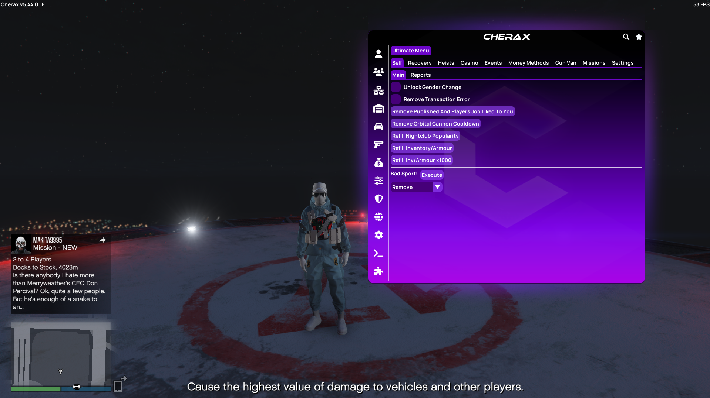

# Ultimate Menu for Cherax

## Install

1. Legacy: Copy the `Ultimate_Menu_CheraxLE.lua` file to `C:\Users\YOURUSERNAME\Documents\Cherax\Lua`.

    Enhanced: Copy the `Ultimate_Menu_CheraxEE.lua` file to `C:\Users\YOURUSERNAME\Documents\Cherax\Lua`.

2. Go to the `Lua Editor` in Cherax.

3. Select the Script in the Dropdown and click on `Start Script`.

Online features become available after joining GTA Online.

## Supported builds

- GTA V Legacy 3889
- GTA V Enhanced 1158.13
  
---

<h2 align="center">📸 Cherax Preview (Legacy)</h2>

  

---
