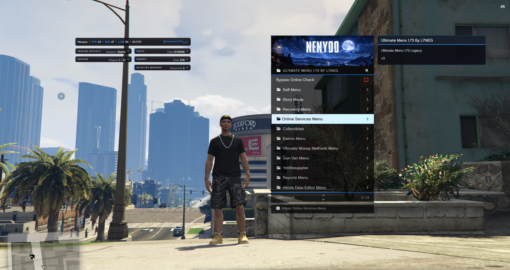
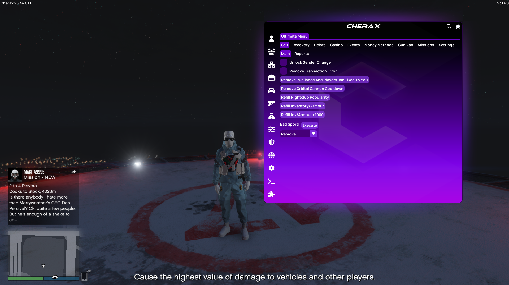

  

<h1 align="center">Ultimate Menu</h1>

<em>A powerful menu script featuring advanced recovery options, money tools, a Heist Editor, and much more.</em>

  <a href="https://www.unknowncheats.me/forum/grand-theft-auto-v/565688-ultimate-menu-script.html">[ModestMenu UKC Thread]</a> • 
  <a href="https://www.unknowncheats.me/forum/grand-theft-auto-v/597103-ultimate-menu-yimmenu.html">[YimMenu UKC Thread]</a> • 
  <a href="https://github.com/UltimateMenu/UltimateMenu?tab=readme-ov-file#-faq">[FAQ]</a>

> [!NOTE]  
> [How To Use YimMenu After BattlEye Anticheat Update (Legacy & Enhanced)](https://github.com/UltimateMenu/UltimateMenu/wiki/How-To-Use-UM-Script-With-YimMenu-After-Battleye-Anticheat-(Legacy-&-Enhanced))

---

<h2 align="center">📸 YimMenu Preview (Legacy)</h2>

  

---

<h2 align="center">📸 Nenyoo Preview (Legacy)</h2>

  

---

<h2 align="center">📸 Cherax Preview (Legacy)</h2>

  

---

## ❓ FAQ

### How To Use?

  
<strong>Yimmenu</strong>

- For **YimMenu Legacy**:  
  Open YimMenu → `Settings` → `Lua` → `Open Folder` → `scripts`  
  → Paste the `.lua` file there. That’s it!

- For **YimMenuV2 Enhanced**:  
  Copy the `Ultimate_Menu_Enhanced.lua` file from [`YimMenu`](YimMenu) to `C:\Users\YOURUSERNAME\AppData\Roaming\YimMenuV2\scripts`.

  Go to `Settings` → `Lua` in YimmenuV2.

  Select the Script and Load it.

  
<strong>Nenyoo</strong>

  
- For **Nenyoo GTA V Legacy or Enhanced**:
  Copy the contents of [`Nenyoo`](Nenyoo) to `%LOCALAPPDATA%\Nenyoo\Plus\Scripts\User\UltimateMenu\`.

  In Nenyoo, open `Scripts` and select `Ultimate_Menu.lua` to load its menu page.

  The `lib` folder must stay beside the entry script.

  Join GTA Online before using online actions.

  Supported builds: Legacy 3889 and Enhanced 1158.13. The matching offsets are selected automatically.

  
<strong>Cherax</strong>

  
- For **Cherax GTA V Legacy**:
  Copy `Ultimate_Menu_CheraxLE.lua` from [`Cherax`](Cherax) to `C:\Users\YOURUSERNAME\Documents\Cherax\Lua`.

  In Cherax, open `Lua Editor`, select `Ultimate_Menu_CheraxLE.lua` and Click on Start Script.

- For **Cherax GTA V Enhanced**:
  Copy `Ultimate_Menu_CheraxEE.lua` from [`Cherax`](Cherax) to `C:\Users\YOURUSERNAME\Documents\Cherax\Lua`.

  In Cherax, open `Lua Editor`, select `Ultimate_Menu_CheraxLE.lua` and Click on Start Script.

### Features

  
<strong>Self</strong>

- Unlock Gender Change (toggle)
- Remove Transaction Error (toggle)
- Remove Published And Players Job Liked To You
- Remove Orbital Cannon Cooldown
- Refill Nightclub Popularity
- Bad Sport (select + Execute)
- Refill Inventory/Armour, Refill Inventory/Armour x1000

**Reports**

- Shows your report counters (Griefing, Exploiting, Hate Speech, ...)
- Shows your commendations (Friendly, Helpful)

  
<strong>Recovery</strong>

**Skills**

- Max Current Skills
- Reset Skills

**Collectibles**

- Collect All Action Figures, Signal Jammers, Playing Cards, Props, Movie Props, LD Organics
- Collect Ghost Exposed

**Awards Unlocker**

- Awards: Victory, General, Weapons, Crimes, Vehicles, Combat
- Heist Awards: Apartment, Diamond Casino, Cayo Perico, Doomsday
- DLC Awards: The Kortz Center Heist, A Safehouse In The Hills, Agents of Sabotage, After Hours, Arena War, Diamond Casino n Resort, Arcade, LS Summer Special, LS Tuners, Contract

**Account Unlocker**

- Unlock WM 29 Pistol, The Shocker, The Snowball Launcher
- Complete All Daily + Weekly Challenges
- Achievements: Unlock All Achievements
- Achievements: unlock each of the 77 achievements one by one

**LSCM Unlocker**

- Unlock All Rep Lvl 1000
- LSCM Prize Ride Unlock
- Unlock Trade Prices for Headlights
- Tutorial

  
<strong>Heists</strong>

**Apartment**

- Preps: select heist + Apply + Complete Preps
- Bypass Fleeca Hack, Bypass Fleeca Drill, Bypass Pacific Hack
- Skip Checkpoint, Unlock All Jobs, Skip Cutscene, Force Ready, Instant Finish
- Kill Cooldown, Change Session
- Cuts: 3mil Payout, Player 1-4, Apply Cuts, Read Cuts
- Cut Presets: 0%, 25%, 85%, 100%
- Solo Launch (toggle)
- 12mil Bonus (toggle)
- Team Lives
- Board Limits: Ceiling, Max Cut %, Apply Custom Limits, Raise / Reset / Read Board Limits

**Cayo Perico**

- Preps: Difficulty, Approach, Loadout, Target, Compound Target/Amount, Arts Amount, Island Target/Amount
- Apply + Complete Preps, Reset Preps, Reload Planning Screen
- Primary Payouts: Panther Statue, Madrazo Files, Pink Diamond, Bearer Bonds, Necklace, Tequila
- Cuts: Remove Crew Cuts, Player 1-4, Apply Cuts
- Cut Presets: 0%, 25%, 85%, 100%, 2.55mil Payout
- Team Lives, Bag Size, Loot Take
- Solo Mantrap (Dual Keycard), Take Secondary Target
- Bypass Drainage Cut, Bypass Fingerprint Scanner, Bypass Plasma Cutter
- Remove All CCTVs, Instant Finish, Skip Cutscene, Force Ready
- Kill Cooldown (after solo / after team)
- Teleports: Front Gate, El Rubio's Office, Primary Target, Secondary Target, Safe Zone, Entrance Drainage Pipe, Enter Cayo Perico, Elevator

**Casino Heist**

- One Click Setups: Silent+Sneaky, The Big Con, Aggressive (Diamonds)
- Preps: Difficulty, Approach, Gunman, Loadout, Driver, Vehicles, Hacker, Masks, Guards, Keycards, Target
- Apply + Complete Preps, Reset Preps, Reload boards
- Solo Launch, Kill Cooldown
- Team Lives
- Cuts: Remove Crew Cuts, Player 1-4, Presets, Apply Cuts
- Extras: Autograbber (toggle), Bypass Fingerprint Hack, Bypass Keypad Hack, Bypass Drill Vault Door
- Extras: Instant Finish, Force Ready, Skip Cutscene

**Doomsday**

- Preps: select act + Complete Preps, Reset Preps
- Team Lives
- Instant Finish (Act I/II), Instant Finish (Act III Scenario)
- Cuts: Cut 1-4, Presets, Apply Cuts
- Act III Hack Bypass, Solo Launch, Force Ready, Skip Cutscene

**Salvage Yard**

- Robbery Slots: Slot, Robbery, Vehicle, Modification, Status, Apply Changes, Make Available
- Payout: Sell Value Slot 1-3, Apply Sell Values
- Complete Preps, Reset Preps, Reload Screen, Skip Weekly Cooldown
- Instant Finish, Instant Sell, Skip Cutscene
- Collect Safe (Enhanced only)

**Kortz**

- Status overview
- Payout Settings: Multiplier, Custom Value, Reset This Target
- Team Lives, Bag Size, Weekly Multiplier
- Difficulty: Hard Mode, Normal Mode
- High Priority Preps: Unmarked Weapons, Getaway Vehicle, Guard Routes, Glass Cutter, Power Drills
- Optional Preps: Hazmat Suit, Tactical Equipment, Annihilator Stealth, Manchez, EMP Charges, Guard Shipments
- Scoping: Points of Interest, All Secondary Targets
- Required Preps: Scope Out Kortz Center, Alpha Mail Disguise, Staff Key Card, Hacking Device, Access Code
- Optional Upgrades: Vault Keypad, EMP Charges, Street/Security/Military Loadout, Staff Entrance, Sewer, Manhole Key + Location, Red/Blue/Green/Yellow Manchez, Advanced Avionics, Weak Guards
- Primary Target select
- Reload Planning Board, Skip Cutscene, Skip Cooldown, Unlock All Paintings
- Complete All Selections, Reset (Keep Target Only)
- Mission Cracker: Auto Door Hacks (toggle), Auto-Enter Access Code, Disable Lasers, Lasers Easy/Hard, No Damage Lasers
- Mission Cracker: Solo Secondary Targets (B2 Floor), Loot Take
- Mission Cracker: Skip Data Crack, Skip Fingerprint Hack, Skip Vault Door Hack
- Mission Cracker: Cut All Glass, Venus d'Algernon, Gemstone, Horse, Coquard Carcanet, Memento Non Mori, Glass Case Status
- Mission Cracker: Take Primary Target, Take Secondary Target

**Flash Ops**

- Agency: select contract + Complete Preps, Agency Safe Loop (toggle), Instant Finish, Skip Cutscene, Collect Safe (Enhanced only), Kill Cooldowns, Payout
- Autoshop: select contract + Apply + Complete Preps, Reset Preps, Redraw Board, Payout, Instant Finish, Skip Cutscene
- Cluckin Bell Heist: select prep + Apply + Complete Preps, Reset Preps
- Guzman Flies: select stage + Apply + Complete Preps, Reset Preps, Teleport to Entrance / Laptop
- Guzman Flies options: Hard Mode, Additional Mogul, Additional Iron Mules, Insurgent Pick-Up Custom, Weapon Crate, Heavy Armor, Mogul Upgrades, Enable / Disable All
- Guzman Flies: Instant Finish, Skip Cutscene, Kill Cooldown

**Teleports**

- Arcade / Casino Exterior: Arcade (Owned), Videogeddon Arcade, Diamond Casino Entrance, Casino Parking
- Casino Interior: Vault 1-6, Vault Lobby Enter / Exit
- Cayo Perico: Main Dock, Main Loot, Office, Vault Loot, Main Loot Gate, North Safe, Storage 1-4, Power Station, Comm Tower, Cayo Exit, Cayo Airstrip
- Classic Robberies: Fleeca Bank (Burton), Pacific Standard Bank, Doomsday Facility (Owned)
- Agency / Dre: Dre 1-4, ULP Place, Intelligence A / B
- New Robberies: Kortz Center Entrance, Cluckin Bell Factory, Agency (Owned), Auto Shop (Owned), Salvage Yard (Owned)

  
<strong>Casino</strong>

- Casino Chips: Chip Limit, Apply Acquire Limit, Apply Trade In Limit, Bypass Casino Cooldown
- Lucky Wheel: Podium Vehicle, Mystery Prize, $50,000, 25,000 Chips, 15,000 RP, Discount, Clothing
- Rig Slot Machines, Lose Slot Machines

  
<strong>Events</strong>

- Snow (toggle)
- Halloween Weather (toggle)
- Trick or Treat (toggle), Teleport to Location 001-040, Teleport to Random Jack o'Lantern
- Snowmen Collectibles (toggle), Teleport to Location 01-25, Teleport to Random Snowman
- Yeti Hunt (toggle), Clue Location 1-5, Yeti Fight Location 1-2, Teleport to Random Yeti Location

  
<strong>Business</strong>

**Hangar Cargo**

- Crate Value
- Maximize Price (toggle), No XP Gain (toggle), Instant Air Cargo Sell
- Skip Setup, Teleport to Entrance, Teleport to Laptop, Kill Cooldowns (toggle)
- Remove Ron's Cut (toggle), Disable Player RP Gain (toggle), Open Hangar Screen
- Get Cargo, Turkish Supplier (toggle)
- Hangar Stats: Buy Made / Undertaken, Sales Made / Undertaken, Earnings, Refresh, Apply

**Bunker**

- Maximize Price (toggle), No XP Gain (toggle), Instant Sell
- Skip Setup, Teleport to Entrance, Teleport to Laptop, Open Laptop
- Get Supplies, Trigger Production, Turkish Supplier (toggle)
- Bunker Stats: Sales Made / Undertaken, Earnings, Refresh, Apply

**Money Fronts**

- Hands On Car Wash, Higgins Helitours, Smoke on the Water: Teleport to Entrance / Laptop, Lock Heat (toggle), Max / Min Heat, Heat Percentage
- Overall Heat: Lock Heat (toggle), Max / Min Heat, Heat Percentage

**Nightclub**

- Maximize Price (toggle)
- Fill Safe, Collect Safe, Unbrick Safe
- Nightclub $300k/5s (Safe Remote AFK) (toggle)
- Skip Setups, Teleport to Entrance, Teleport to Computer, Open Computer, Kill Cooldowns (toggle)
- Popularity: Lock Popularity (toggle), Max / Min Popularity, Popularity (0-100%)
- Nightclub Stats: Sales Made, Earnings, Refresh, Apply

**Special Cargo**

- Maximize Price (toggle), No XP Gain (toggle), No CrateBack (toggle), Instant Sell
- CEO Manager: Crate Value, Open Warehouse Screen, Start CEO Manager (toggle)
- Crates Amount (0-111), Max Crates Amount, Instant Buy, Get Crates, Turkish Supplier (toggle)
- Teleport to Office, Teleport to Computer, Teleport to Warehouse, Kill Cooldowns (toggle)
- Special Cargo Stats: Buy Made / Undertaken, Sales Made / Undertaken, Earnings, Refresh, Apply

**Misc**

- Resupply selected business
- Bail Office: Teleport to Entrance / Computer
- Collect Safe of selected business (Enhanced only)
- Garment Factory: Teleport to Entrance / Computer, Unbrick Computer

  
<strong>Gun Van</strong>

- Set New Gun Van Location, Teleport, Teleport To Gun Van, Reset Position, Set Waypoint, Mark On Map
- Weapon Skins, Remove Livery Lock, Blip Always Visible, Jewish Trade Skills (-10%) (toggles)
- Stock: Weapons, Throwables, Body Armor, Edit Weapons
- Unlock Gun Van, Drive Gun Van, Seller Shootable
- Discount %, Apply Discounts
- Set Throwable, Optimal Gun Van Slots, Reset Gun Van Slots

  
<strong>Missions</strong>

- Remove Dax Fooligan Missions Cooldown
- Remove VIP/MC Cooldown
- Skip Yacht Missions
- LSA Operations Instant-Finish

  
<strong>Settings</strong>

- Copy Discord / GitHub / Website Link
- Bypass Online Check (toggle)
- Credits
- Hide each main tab (Self, Recovery, Heists, Casino, Events, Business, Gun Van, Missions)

---

## 📅 Update Info

- **Ultimate Menu for ModestMenu**: Last updated on **Dec 12, 2024** *(Final Update)*  
- **Ultimate Menu for YimMenu Legacy**: Last updated on **Jul 24, 2026**
- **Ultimate Menu for YimMenuV2 Enhanced**: Released on **Nov 15, 2026**
- **Ultimate Menu for Nenyoo**: Legacy and Enhanced support
- **Ultimate Menu for Cherax Legacy**: Last updated on **Nov 15, 2026**
- **Ultimate Menu for Cherax Enhanced**: Released on **Nov 15, 2026**

---

## 🛠️ About

This is a fun and helpful free project for the community.  
There is **no ETA** for future big updates, as I’m currently focused on studying and personal life.

You're welcome to fork, use, and build on this script for your own needs.  
Treat it as a base or template if you wish.

Credits For Everything I Used Is Included In The Script.

---

<h2 align="left">💬 Discord Server</h2>

  

---

**Thanks for using Ultimate Menu Made With ❤️ By L7NEG & Contributors/Helpers**
